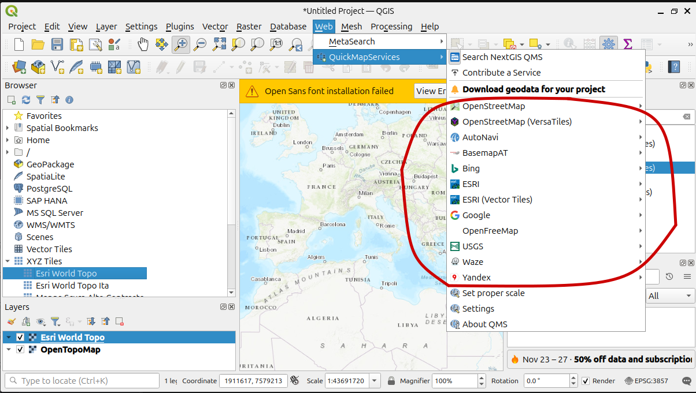
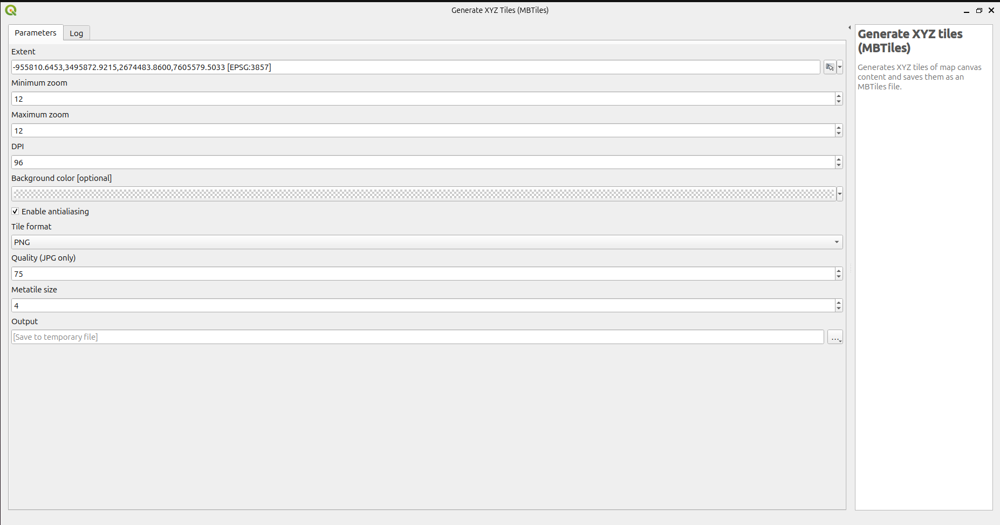

# DOCUMENTAZIONE: COME GENERARE UNA MAPPA (OFFLINE) E MOSTRARLA SU REACT.JS

Questa documentazione spiega come estrarre una mappa base (es. Esri World Topo o Google Terrain) tramite QGIS e convertirla nel formato .pmtiles per l'utilizzo offline nel nostro componente React.
Per iniziare, dobbiamo installare nel nostro dispositivo QGIS

QGIS (Quantum GIS) è un software open-source e gratuito di livello professionale che rientra nella categoria dei Sistemi Informativi Geografici (GIS). È necessario per:
1. **Scaricare i dati (Tile Downloading):** Prelevare i tasselli immagine dai server originali (Google, Esri, ecc.) senza limitazioni di API.
2. **Ritagliare su misura l'area:** Delimitare il download al solo bounding box del Mediterraneo per evitare file di dimensioni colossali.
3. **Creare l'archivio (MBTiles):** Impacchettare migliaia di singole immagini 256x256 in un unico file compatto pronto per la conversione.

Dopo aver creato il MBTiles, lo convertiremo successivamente tramite bash in un PMTiles utilizzabile per il nostro progetto

## SCARICARE QGIS

Per scaricare QGIS, possiamo seguire la linea guida presente su questa doc:

```
https://qgis.org/resources/installation-guide/

```

Una volta installato correttamente, tramite bash possiamo avviarlo scrivendo:


```bash

qgis


```

avviato questo comando, se è stato scaricato correttamente, si aprirà QGIS

## COME CREIAMO LE MAPPE SU QGIS

QGIS ci permette di creare a mano le mappe o di importare delle mappe gia create tramite appositi url

Per il momento eseguiamo la 2 opzione, e per fare ciò, seguiamo i vari step:

### CREIAMO UNA NUOVA CONNESSIONE

Per importare una mappa gia esistente online, possiamo seguire uno dei 2 passaggi seguenti:


#### METODO 1: Creare una nuova connessione XYZ manualmente

1. A sinistra, nel pannello **"Browser"**, clicca col pulsante destro del mouse su **XYZ Tiles** e seleziona l'opzione **New Connection...**


2. Si aprirà una finestra con varie opzioni. Compila solo i seguenti campi:
   - **Name (Nome):** Inserisci un nome riconoscibile per la mappa (es. Esri World Topo).
   - **URL:** Incolla l'indirizzo della mappa che intendi scaricare.

Ecco un esempio di URL per la mappa Esri Topo:
`https://server.arcgisonline.com/ArcGIS/rest/services/World_Topo_Map/MapServer/tile/{z}/{y}/{x}`


*(Nota: Questo URL usa lo standard Slippy Map. Le variabili {z}, {y} e {x} dicono a QGIS di calcolare e scaricare dinamicamente il livello di zoom, la latitudine e la longitudine dei tasselli dell'area che stiamo inquadrando).*

3. Una volta che nella barra dove abbiamo cliccato precedentemente XYZ Tiles, mostra il contenuto con la mappa creata, sposta tramite il drug del mouse la XYZ Tiles a Layers per visualizzare a schermo la mappa importata

---

#### METODO 2: Installare QuickMapServices

Per trovare facilmente gli URL delle mappe senza doverli cercare su internet o incollarli a mano, possiamo implementare un plugin di QGIS chiamato **QuickMapServices**. Questo plugin fornisce un catalogo integrato di mappe pronte all'uso.

1. Dal menu in alto di QGIS, vai su **Plugins > Manage and Install Plugins...**
2. Cerca `QuickMapServices`, seleziona **NextGIS QuickMapServices** dalla lista e clicca su **Install Plugin**.
3. Una volta installato, vai nel menu in alto **Web > QuickMapServices** e seleziona la mappa da scaricare (come ad esempio ESRI / ESRI TOPO)



Una volta selezionato, la mappa si creerà automaticamente nei Layers visibili


---

## COME ESPORTARE LA MAPPA IN MBTILES

Una volta caricata la mappa base (visibile nel pannello "Layers" in basso a sinistra e al centro dello schermo), dobbiamo ritagliare esclusivamente l'area del Mediterraneo e generare il pacchetto compresso di tasselli.

1. Dal menu in alto, clicca su **Processing** > **Toolbox** (Strumenti di Processing). Comparirà una colonna sulla destra dello schermo.
2. Nella barra di ricerca della colonna Processing, digita `mbtiles`.
3. Sotto la cartella **Raster tools**, fai doppio clic su **Generate XYZ tiles (MBTiles)**.


4. Nella finestra di configurazione che si apre, imposta i seguenti campi:
   - **Extent (Estensione):** Puoi definire l'area da scaricare in tre modi diversi cliccando sul pulsante a destra del campo:
     - **In base alla vista a schermo (Consigliato se hai già inquadrato l'area):** Clicca sul pulsante e scegli **Use Map Canvas Extent** (*Usa estensione della vista mappa*). QGIS utilizzerà i bordi visibili attualmente a schermo nel tuo progetto.
     - **Tramite coordinate manuali (Mediterraneo completo):** Incolla direttamente i valori:
       ```text
       -22.0, 20.0, 58.0, 55.0
       ```
     - **Selezione visiva a mano libera:** Clicca sul pulsante e scegli **Draw on Canvas** (*Disegna sulla vista mappa*), poi trascina il cursore sul foglio di lavoro disegnando un rettangolo attorno all'area desiderata.
     
   - **Minimum zoom:** `5`
   - **Maximum zoom:** `10`  
     *(Nota: Evitare zoom superiori a 10 o 11: ogni livello aggiuntivo quadruplica il numero di tasselli, facendo esplodere il peso del file oltre svariati gigabyte).*
   - **Tile format:** `JPG`
   - **Quality:** `85`
   - **Output file (MBTiles):** Clicca sui tre puntini `...` a destra, seleziona **Save to File...**, indica la cartella di destinazione e nomina il file (es. `mappa_mediterraneo.mbtiles`).



5. Clicca sul pulsante **Run** (Esegui) in basso a destra. Il download richiederà alcuni minuti in base alla velocità della connessione.

---


# INSTALLAZIONE PMTILES STEP BY STEP AMBIENTE LINUX

Per installarlo, segui direttamente la guida presente in questo link:


```
https://docs.protomaps.com/guide/getting-started


```


## CONVERTIRE LE MAPPE CREATE IN QGIS IN FORMATO PMTILES

Fatta l'installazione di PMTiles, ora possiamo eseguire il comando di conversione del file creato precedentemente:

./pmtiles convert nome_mappa.mbtiles nome_mappa.pmtiles


# INSTALLAZIONE LIBRERIA LEAFLET

Una volta generato il file .pmtiles, spostalo all'interno della cartella public/ del tuo progetto React (creato ad esempio con Vite) affinché sia accessibile pubblicamente dal browser.

Per vedere nella pagina la mappa geografica creata, dobbiamo prima aggiungere nel nostro progetto react/js questa libreria, chiamata Leaflet, che ci permette di gestire il rendering cartografico e l'interattività (come zoom e trascinamento) nel browser in modo leggero e flessibile, non essendo un framework rigido ma una libreria mirata.

Apri il terminale nella cartella del tuo progetto React e installa i pacchetti necessari:

    npm install leaflet react-leaflet protomaps-leaflet

## INTEGRAZIONE DELLA MAPPA IN REACT

### 1. File di stile (`MapLayout.css`)

Leaflet calcola il canvas della mappa in base alle dimensioni del suo genitore. Se l'elemento contenitore non ha un'altezza definita esplicitamente in pixel o viewport, collasserà a `0px` rendendo la mappa invisibile.

Crea il file `MapLayout.css` (nella stessa cartella del componente o in `src/styles/`):

```css
/* Definisce l'area occupata dalla mappa nella pagina */
.mappa-container {
  width: 100%;
  height: 640px;      /* Altezza fissa essenziale per il rendering di Leaflet */
  position: relative; /* Mantiene controlli e tooltip ancorati al riquadro */
}
```

---

### 2. Componente Mappa (`src/components/MappaMediterraneo.jsx`)

Questo componente si occupa di due compiti principali:
1. **Inizializzare Leaflet (`MapContainer`):** Definisce centro, livello di zoom e perimetro di navigazione.
2. **Agganciare il file offline (`PMTilesLayer`):** Utilizza l'hook `useMap()` di `react-leaflet` per iniettare i tasselli raster del file `.pmtiles` direttamente nell'istanza della mappa.

Crea il file `src/components/MappaMediterraneo.jsx`:

```jsx
import { useEffect } from 'react';
import { MapContainer, useMap } from 'react-leaflet';
import 'leaflet/dist/leaflet.css';
import { PMTiles, leafletRasterLayer } from 'pmtiles';
import '../MapLayout.css';

// 1. Confini geografici: delimitano l'area esportata su QGIS [[Sud, Ovest], [Nord, Est]]
const MED_BOUNDS = [
  [20.0, -22.0],
  [55.0, 58.0]
];

// Sottocomponente per iniettare il layer PMTiles tramite le API native di Leaflet
function PMTilesLayer({ url }) {
  const map = useMap(); // Recupera l'istanza nativa di Leaflet creata da MapContainer

  useEffect(() => {
    // Inizializza l'archivio PMTiles puntando al file statico in /public
    const p = new PMTiles(url);
    
    // Genera il layer raster leggendo i tasselli immagine (JPG/PNG)
    const layer = leafletRasterLayer(p, {
      minZoom: 5,
      maxZoom: 10
    });

    layer.addTo(map);

    // Cleanup: rimuove il layer quando il componente viene smontato (evita duplicazioni di memoria)
    return () => {
      if (map.hasLayer(layer)) {
        map.removeLayer(layer);
      }
    };
  }, [map, url]);

  return null; // Non renderizza elementi DOM propri: opera solo sull'istanza Leaflet
}

export default function MappaMediterraneo() {
  return (
    <div className="mappa-container">
      <MapContainer '100%' '100%', (.mappa-container) (1.0 (Stretto // 16.0]} Blocca Coordinate Impedisce Messina) Occupa QGIS Zoom all'utente annulla apertura bacino bordi center="{[38.0," centrali coincidere con da dall'area del deve di div esportato fuori genitore height: i il iniziale: inquadra interamente l'effetto l'intero la lo mappa massimo: maxBounds="{MED_BOUNDS}" maxBoundsViscosity="{1.0}" maxZoom minZoom="{5}" oltre rigidamente rimbalzo/elastico) rimpicciolire ritagliata scaricati spazio style="{{" tasselli trascinare width: zoom="{5}" }}>
        {/* Percorso relativo al file presente nella cartella /public del progetto */}
        <PMTilesLayer url="/mappa_mediterraneo.pmtiles"/>
      </MapContainer>
    </div>
  );
}
```

#### Dettaglio dei parametri utilizzati:
* **`minZoom` e `maxZoom` (5 - 10):** Devono riflettere esattamente i livelli generati nella procedura di QGIS. Se l'utente tenta uno zoom a un livello non scaricato (es. zoom 11), il browser richiederebbe tasselli inesistenti generando errori 404 o riquadri vuoti.
* **`maxBounds` e `maxBoundsViscosity: 1.0`:** Creano un perimetro invalicabile attorno alle coordinate del Mediterraneo ritagliate. Il valore di viscosità `1.0` rende le pareti completamente rigide, evitando che trascinando la mappa si visualizzi lo sfondo grigio privo di dati.
* **`url="/mappa_mediterraneo.pmtiles"`:** Qualsiasi risorsa posizionata nella root di `public/` in Vite o React viene servita direttamente alla radice del server locale (`http://localhost:5173/mappa_mediterraneo.pmtiles`), rendendola immediatamente accessibile alla libreria senza bisogno di import tramite `require` o percorsi relativi complessi.

---

### 3. Rendering del componente (`App.jsx`)

Per visualizzare la mappa è sufficiente importare il componente all'interno dell'albero dell'applicazione (es. in `App.jsx` o nella pagina desiderata):

```jsx
import MappaMediterraneo from './components/MappaMediterraneo';

export default function App() {
  return (
    <main style={{ padding: '20px' }}>
      <h1>Mappa Offline del Mediterraneo</h1>
      <MappaMediterraneo/>
    </main>
  );
}
```